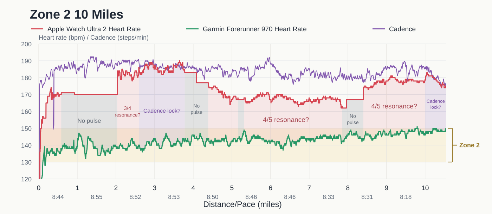
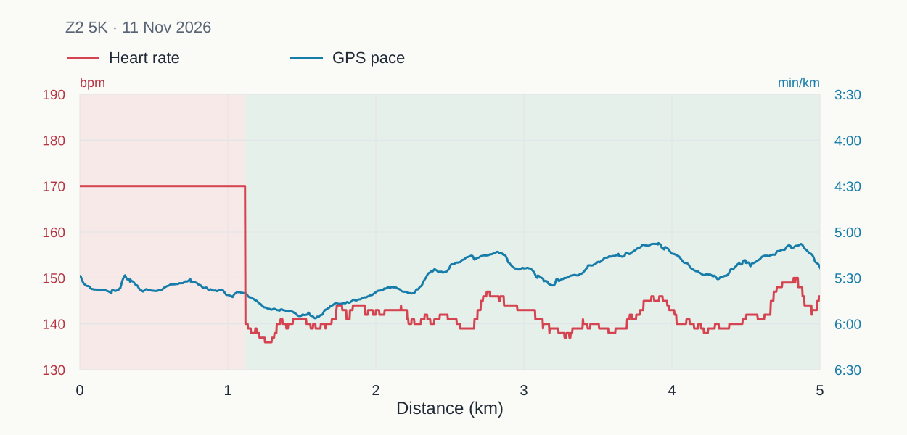
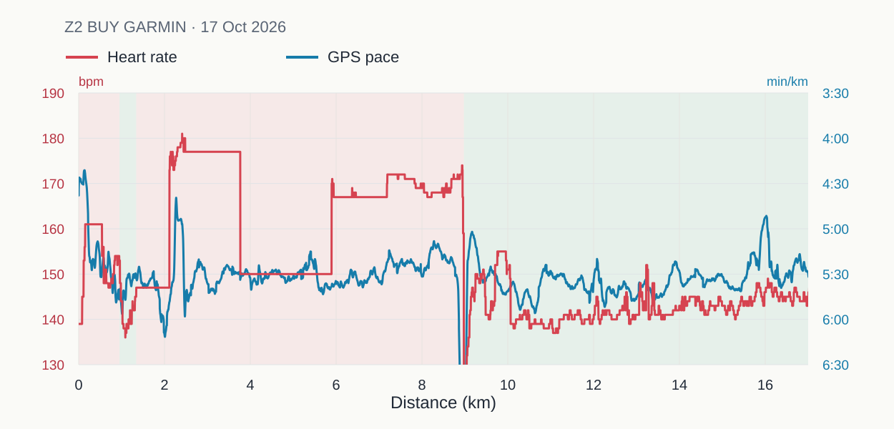
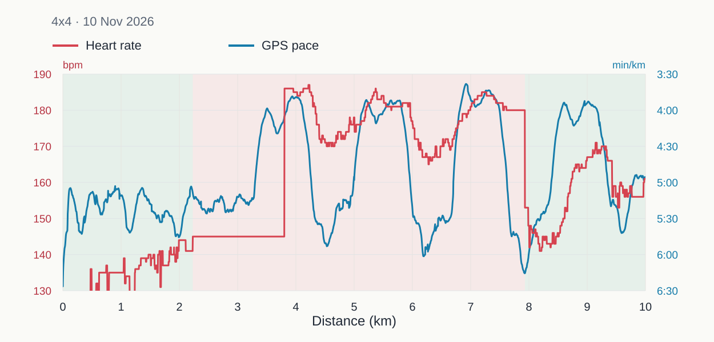
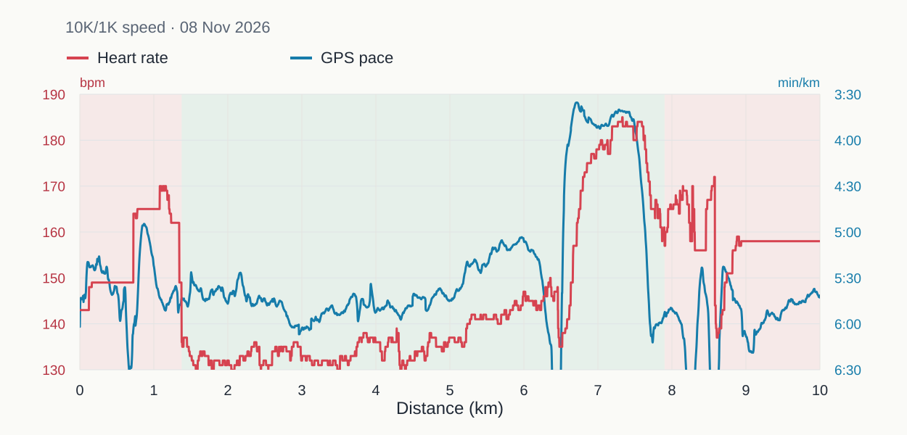
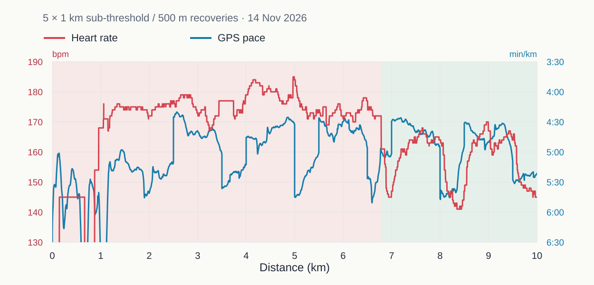
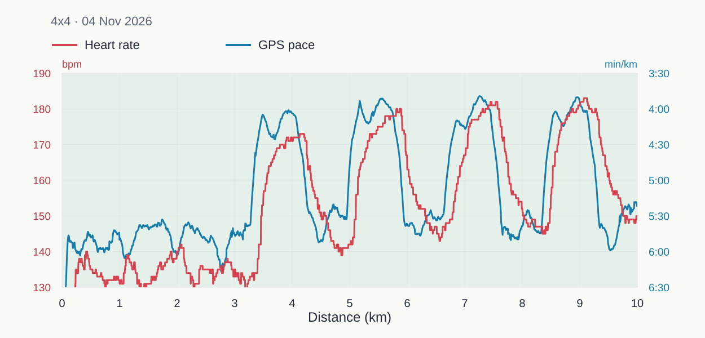
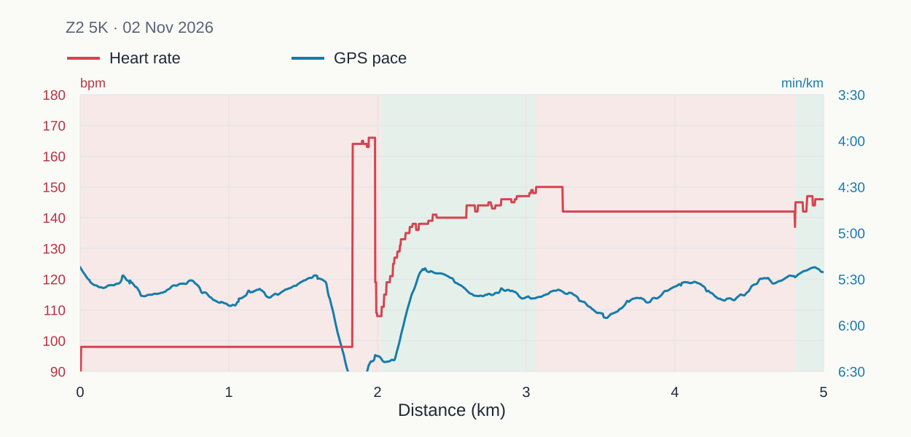

# Apple Watch Heart Rates Woes

*all words written by human*

I've had the Ultra 2 for 3 years now, it's heart rate monitor has never been very trustworthy, but have been reliable often enough to not make it the centerpiece of my exercise. However, recently, it's gotten so bad that all of my attention during my exercise are now on my watch, to relief, if the number correlates to feeling, or frustration, when it obviously is wrong. This is happening so often now, that it is impossible to ignore the daily failing of the apple watch.

Here we talk exclusively about the heart rate, but there was also: [*Apple Watch's Disastrous Upgrade*](/blog/post.html?slug=apple-watch-sucks) about the time when the upgrade to Watch OS broke the distance as well; That seemed to be fixed, the heart rate unfortunately is not. And given all of the failing demonstrated here, it's hard to argue it's not another software bug.

## There is competition

After weeks of torment, I've finally got borrowed wife's Garmin Forerunner 970, wearing it side by side, expecting that maybe it's an universal issue, turns out, it was not. The garmin performed perfectly for the entire run, and Apple watch failed the entire way, I graphed it and it can't be more obvious:

What I found striking is the feeling that every bump and variation in the heart rate being explanable is such an refreshing feeling, that they are actually real and I can look down, consult with the number and reinforce my run, versus looking down and finding myself being insulted by the numbers. And that stayed true the entire run. The whole reason why the number is there, is not for us to look at it all the time, but to gauge it when we feel like we are either going too hard or too easy, and that's a refreshing feeling that I have not had for a long time.

For the purpose of experiment, I'm going to keep trying wearing both for my runs to be more accurate - the anecdote is not promising for Apple Watch so far.

I'm going to go into some of the other runs, not an exhaustive list of run with problems, but just the ones that had glaring issues all within last month:

## Bad Beginnings

You know if you don't babysit the start and just take off the apple watch can decide to straight up not find your pulse for the first K, or first 10K? Sorry if you had to race, but start gently and gradually so your heart rate shooting up don't overwhelm the delicate software in the Apple Watch.

## Failing to Recover

Oh and the reverse is true too! If you stop from an interval, Apple Watch may think there is no way for your heart rate to actually recover, and just keep it there just because:

Oh and the heart rate can just be random and not attached to anythign really. They argue that you want to check your heart rate at the intervals both on and off, but good luck with that:

To give a little bit of credit to Apple Watch - it can be correct, it's not always wrong, this run, is somehow, amazingly, entirely correct as far as my perceived effort goes:

## Complete Failures

Oh and there are just complete failure like this and the one that we posted first with Garmin - when the entire run just fails completely and you have NO ACCURATE HEART RATE, at ANY TIME. Which is almost amusing. Did we just say any change in pace is risky? In fact, if you don't change your pace, things can still fail completely on a simple Z2 run.

